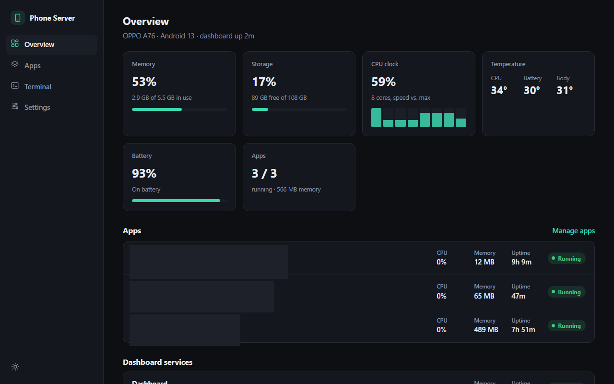
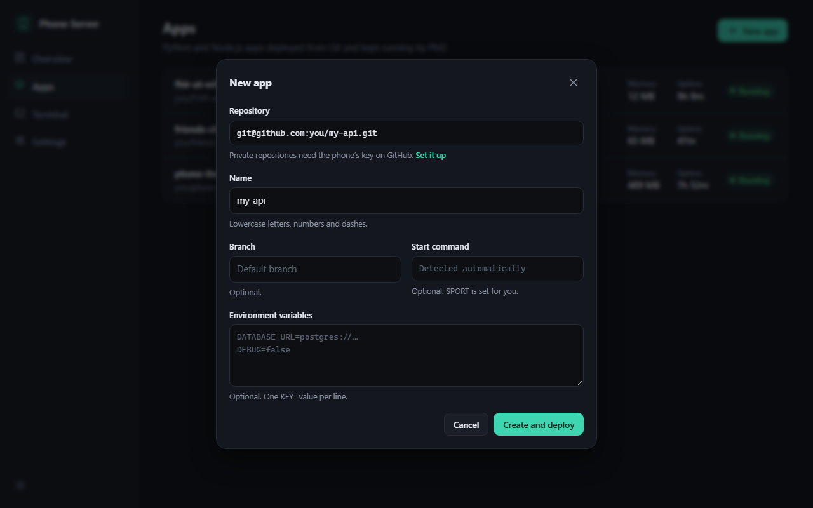
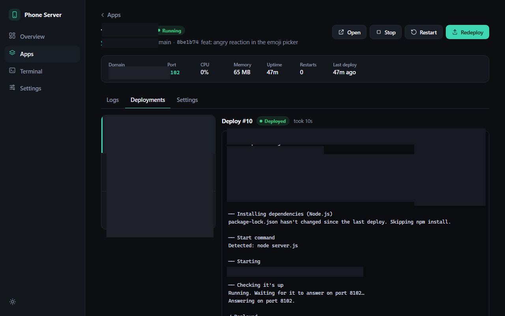
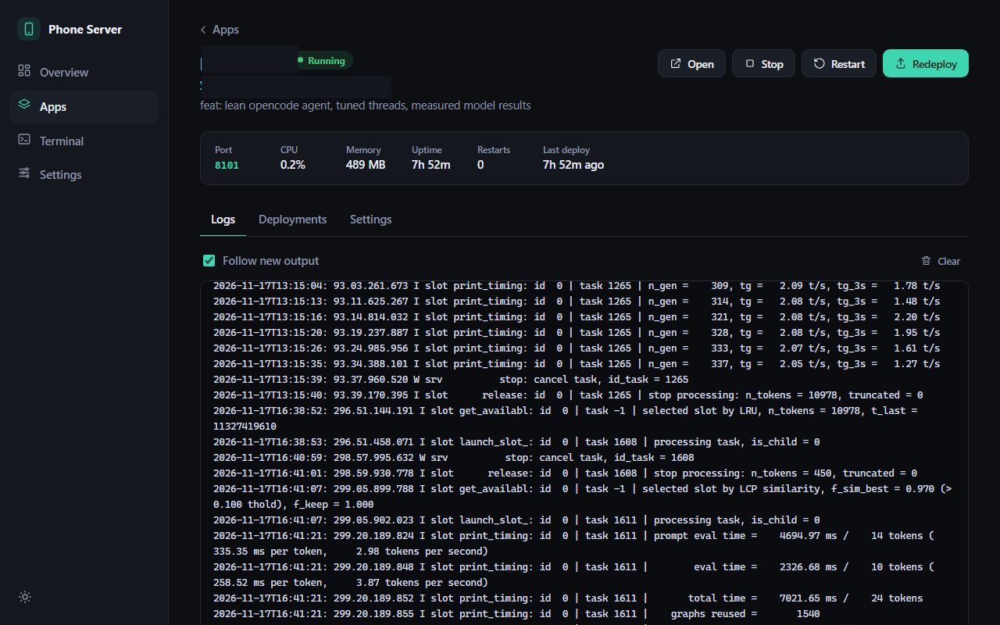
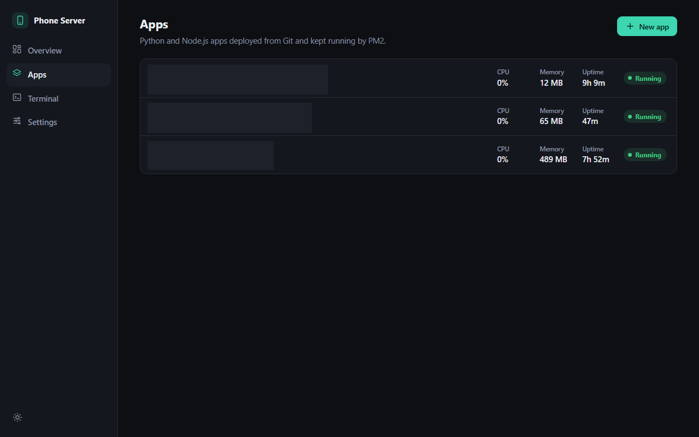
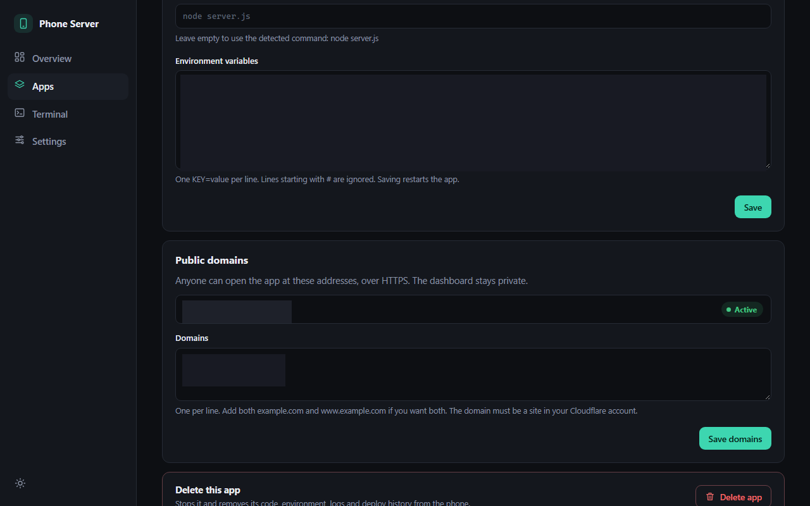
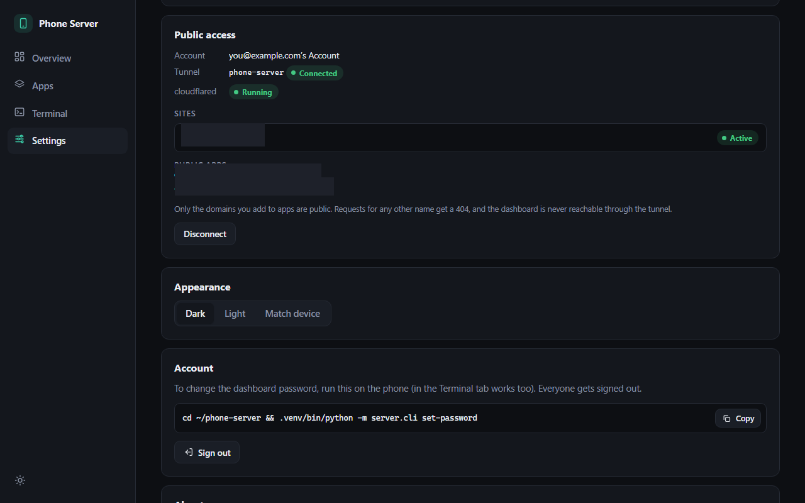
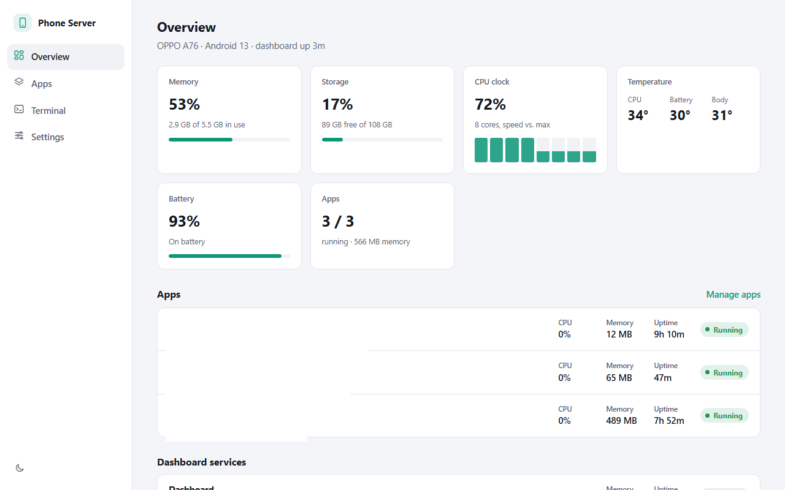
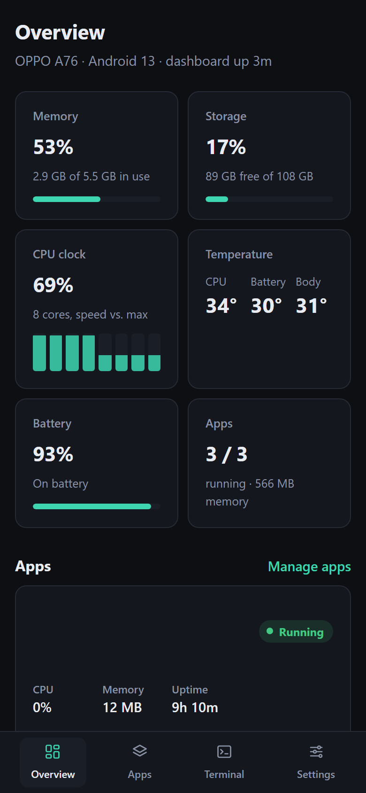
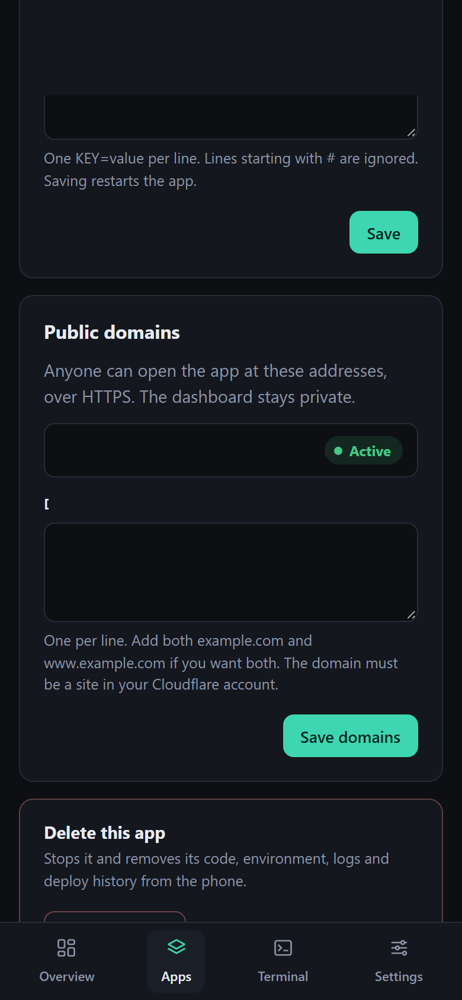

<div align="center">


# Phone Server

**Turn an Android phone into a small, always-on server.**<br>
Deploy Python and Node.js apps from Git, watch them run, and put them on your own domain,
from a dashboard that runs on the phone itself.

[](LICENSE)




</div>

## What you get

- **Deploy from Git.** Paste a repository URL. The phone clones it, installs its dependencies, builds it,
  works out how to start it, and checks that it answers. Python and Node.js are detected for you.
- **See everything live.** Memory, storage, CPU clock speed, temperatures and battery; each app's CPU,
  memory, uptime and restarts; live logs; the full output of every deploy.
- **Control it.** Start, stop, restart, redeploy, and edit the start command, port and environment variables.
- **Your own domains, with HTTPS.** Connect Cloudflare once and give any app a public address. Nothing is
  opened on your router, and it keeps working on mobile data.
- **A database when you need one.** One command gives an app its own PostgreSQL database on the phone.
- **A terminal in the browser**, behind the same sign-in.
- **Private by default.** The dashboard is only reachable over [Tailscale](https://tailscale.com); only the apps
  you choose are public.
- **Survives reboots.** Everything comes back on its own after the phone restarts.

It has run on a mid-range phone (Snapdragon 680, 6 GB RAM, Android 13) hosting a website, a chat app with
its own database, and a small language model at the same time.

## Screenshots

<table>
  <tr>
    <td width="50%"><br><b>Deploy from Git.</b> The name, branch and start command are filled in or detected for you.</td>
    <td width="50%"><br><b>Every deploy is recorded</b>, with its commit and full output.</td>
  </tr>
  <tr>
    <td><br><b>Live logs</b> that follow new output as it arrives.</td>
    <td><br><b>All your apps</b> with their status, CPU, memory and uptime.</td>
  </tr>
  <tr>
    <td><br><b>Public domains per app.</b> Saving creates the DNS records and routes the domain to the app.</td>
    <td><br><b>Cloudflare in one step.</b> Paste an API token; the tunnel is created and kept running.</td>
  </tr>
  <tr>
    <td><br><b>Light and dark</b>, or follow the device.</td>
    <td align="center"> <br><b>Works on a phone too</b>, so you can manage it from anywhere on your tailnet.</td>
  </tr>
</table>

## Quick start

You need an Android phone with [Termux](https://f-droid.org/packages/com.termux/) **from F-Droid** (the Play
Store version is outdated), and [Tailscale](https://tailscale.com/download) on the phone and on your computer.

**1. Install** (in Termux on the phone):

```sh
pkg install -y git
git clone https://github.com/Safwanmahmoud/phone-server ~/phone-server
bash ~/phone-server/scripts/install.sh
```

`install.sh` installs what's missing (Python, Node.js, git, ttyd, Caddy, cloudflared, PM2), creates the
virtual environment, and starts the services. Run it again any time to update.

**2. Set the dashboard password:**

```sh
cd ~/phone-server && .venv/bin/python -m server.cli set-password
```

**3. Open the dashboard** from any device on your tailnet: `http://<phone>:8080`, where `<phone>` is the
phone's name in Tailscale (for example `http://my-phone:8080`).

**4. Keep it running.** Android stops background apps. Follow [Keep it running](#keep-it-running-on-android)
once; it takes about five minutes.

> **From your computer instead:** with an SSH host called `phone` in `~/.ssh/config`, run `scripts/push.sh`
> from a clone of this repository. It copies the folder to the phone and runs `install.sh`.

## Deploying an app

Click **New app**, paste the repository URL, and press **Create and deploy**. The app must listen on
`0.0.0.0:$PORT`; the dashboard sets `PORT` for it (from 8100 to 8199) and opens it at `http://<phone>:<port>`.

| | Node.js | Python |
|---|---|---|
| **Detected when** | there's a `package.json` and no Python packaging files | anything else |
| **Dependencies** | `npm ci` (or `npm install` without a lockfile), dev dependencies included so build tools work. Re-run only when the lockfile changes | a venv per app, from `requirements.txt` or `pip install .`. Re-run only when `requirements.txt` changes |
| **Build** | `npm run build` on every deploy, if there's a `build` script, with the app's variables available | — |
| **Environment** | `NODE_ENV=production` unless you set it | `VIRTUAL_ENV` and the venv on `PATH` |

To work out how to start the app, the dashboard checks, in order:

1. A `Procfile` with a `web:` line
2. **Node.js:** the `start` script (a plain `node server.js` runs directly, anything else through `npm start`),
   then `main`, `server.js` or `index.js`
3. **Python:** FastAPI, Starlette or Quart in `app/main.py`, `main.py`, `app.py` or `server.py` runs
   `python -m uvicorn <module>:app`. Flask runs `gunicorn` if it's installed, otherwise `flask run`.
   Otherwise `python main.py` or `python app.py`.

You can always set your own start command in the app's **Settings**. If the app keeps crashing right after it
starts, the deploy stops it and shows its last output, so it doesn't drain the battery in a restart loop.

- **Private repositories:** **Settings → GitHub access → Create a key for this phone**, add the key at
  <https://github.com/settings/ssh/new>, and use the `git@github.com:you/repo.git` URL.
- **From the terminal:** `cd ~/phone-server && .venv/bin/python -m server.cli deploy <app>` runs the same
  pipeline, prints the log, and shows up in the deploy history.
- **Packages that need Rust** (`pydantic-core` and so FastAPI, `cryptography`, `orjson`): run `pkg install rust`
  first, and expect the first install to take a while.

## Databases

Give apps a PostgreSQL database on the phone:

```sh
bash ~/phone-server/scripts/setup-postgres.sh                              # once
cd ~/phone-server && .venv/bin/python -m server.cli create-db <app>        # for each app
```

The setup script installs PostgreSQL and runs it under PM2 as `ps-postgres`, listening on `127.0.0.1:5432`
only and tuned for a phone (small memory, few background processes). `create-db` makes a database and login
named after the app with a random password, and sets the app's `DATABASE_URL` without printing it. Redeploy
the app, or press **Save** in its Settings, to use it. On the phone, `psql -U postgres` works without a password.

## Public domains

Make an app public at your own domain, over HTTPS, through a free
[Cloudflare Tunnel](https://developers.cloudflare.com/cloudflare-one/connections/connect-networks/).
`cloudflared` only makes outgoing connections, so nothing is opened on your router, and it keeps working on
mobile data or when your home IP address changes.

1. Add your domain to a free Cloudflare account (**Add a domain**, Free plan).
2. At your registrar, replace the nameservers with the two Cloudflare shows (on Namecheap: **Domain List →
   Manage → Nameservers → Custom DNS**). Cloudflare copies your existing records, so email keeps working.
3. Create an API token at **Cloudflare → My Profile → API Tokens → Create Token → Custom token** with
   *Account · Cloudflare Tunnel · Edit*, *Zone · DNS · Edit* and *Zone · Zone · Read*, for all zones.
4. Paste it in **Settings → Public access**. The dashboard creates a tunnel and runs `cloudflared` under PM2
   as `ps-tunnel`. You don't have to wait for the nameservers.
5. In an app's **Settings**, add its domains under **Public domains**, one per line (add both `example.com`
   and `www.example.com` if you want both), and save.

If a name already points somewhere else, the dashboard asks before replacing it. Removing a domain, or deleting
the app, removes only the records the dashboard made, and changing an app's port moves its domains too.

> **Only the domains listed on apps are public.** Any other name gets a 404, and the dashboard, the terminal
> and the database are never reachable through the tunnel.

## Keep it running on Android

Android stops apps in the background. Do these once:

1. **Battery:** Settings → Apps → Termux → Battery → **Unrestricted** (on some phones, *Allow background
   activity*). Do the same for Tailscale.
2. **Start on boot:** install **[Termux:Boot](https://f-droid.org/packages/com.termux.boot/)** from F-Droid and
   open it once. `install.sh` already put the start-up script in place: it takes a wake lock, starts `sshd`,
   and restores every PM2 process. Each start is logged to `~/.phone-server/logs/boot.log`. Some phones also need
   **Auto launch** turned on for Termux and Termux:Boot.
3. **Phantom process killer:** Android 12 and later kill background processes once there are more than 32
   across all apps, and every app you deploy adds at least one. Turn it off once, as shown below.
4. **Battery level on the Overview** (optional): install **[Termux:API](https://f-droid.org/packages/com.termux.api/)**
   from F-Droid, then `pkg install termux-api`.
5. Keep the phone **plugged in**, somewhere cool.

<details>
<summary><b>Turning off the phantom process killer</b></summary>

On Android 14 and later: Developer options → **Disable child process restrictions**.

Otherwise, from a computer with `adb` (USB or wireless debugging):

```sh
adb shell "/system/bin/device_config set_sync_disabled_for_tests persistent"
adb shell "/system/bin/device_config put activity_manager max_phantom_processes 2147483647"
adb shell settings put global settings_enable_monitor_phantom_procs false
```

**Without a computer:** `pkg install android-tools` in Termux, then turn on Developer options → **Wireless
debugging** (needs Wi-Fi). Tap **Pair device with pairing code** and, while that popup is open, run
`adb pair <ip>:<pairing-port> <code>`. Then `adb connect <ip>:<port>` with the port shown on the Wireless
debugging page, and run the commands above. Turn Wireless debugging off afterwards.

The settings survive reboots. On Android 13 only the two `device_config` lines matter; some phones (ColorOS)
refuse the `settings put` line, which is fine there.

</details>

## How it works

```
 browser ──Tailscale──▶ :8080  Caddy ─┬─▶ 127.0.0.1:8000   dashboard (Starlette + uvicorn)
                                      │                         │
                                      └─▶ /terminal ─▶ ttyd     ├─▶ PM2 bridge ─▶ PM2 ─▶ your apps (:8100+)
                                         (sign-in checked       └─▶ SQLite, logs, app folders
                                          first)                    in ~/.phone-server

 visitors ──HTTPS──▶ Cloudflare ──tunnel──▶ cloudflared ─▶ only the apps you gave a domain
```

| Process | What it does |
|---|---|
| `ps-caddy` | The only thing on the network, on port 8080. Before it opens the terminal, it asks the dashboard whether you're signed in. |
| `ps-dashboard` | The API and the UI (`server/`, `static/`), on 127.0.0.1 only. |
| `ps-agent` | Keeps PM2's API loaded (`agent/pm2-agent.js`). The `pm2` command takes 5–15 seconds to start on a phone; the agent answers in milliseconds. |
| `ps-terminal` | ttyd on a Unix socket, so only Caddy can reach it. |
| `ps-postgres`, `ps-tunnel` | PostgreSQL and `cloudflared`, once you set them up. |
| Your apps | One PM2 process each, with its own folder, venv and logs under `~/.phone-server/apps/<name>/`. |

The dashboard uses Starlette rather than FastAPI because FastAPI needs `pydantic-core`, which has to be compiled
with Rust on Termux. The UI is one HTML page, one script and one stylesheet, with no build step.

## Security

- **One password**, set on the phone with `server.cli set-password` and stored as PBKDF2-SHA256 with 600,000
  iterations. Changing it signs everyone out. Sign-in allows 5 wrong passwords per 10 minutes per address.
- **Sessions** are signed cookies. Every request that changes something must carry
  `X-Requested-With: phone-server`, so other websites can't act in your browser.
- **The terminal is a full shell** as the Termux user. Treat the dashboard password like an SSH key.
- **The dashboard is plain HTTP.** Tailscale encrypts traffic between your devices, but on your home Wi-Fi
  (`192.168.x.x:8080`) it isn't encrypted. Use the Tailscale address.
- **Secrets stay on the phone:** app environment variables, the Cloudflare token and database passwords are in
  `~/.phone-server`, readable only by Termux.

## Project layout

```
server/            dashboard (Starlette)
  main.py          routes, sign-in check, exception handlers
  deploy.py        clone/fetch → pip or npm (+ build) → detect start command → PM2 → health check
  pm2.py           talks to the PM2 bridge, or the pm2 command if the bridge is down
  tunnel.py        Cloudflare Tunnel: API token, cloudflared under PM2, app domains and DNS records
  system.py        memory, storage, CPU clock, temperatures, battery
  apps.py          validation and API errors
  db.py            SQLite: apps and deployments
  auth.py, cli.py  password, sign-in, and the command line (set-password, deploy, create-db)
agent/             PM2 bridge (Node)
static/            the UI
scripts/           install.sh, push.sh, boot.sh, run-terminal.sh, setup-postgres.sh
docs/screenshots/  the images in this README
```

Data lives in `~/.phone-server` (or `$PS_DATA`): `phone-server.db`, `apps/<name>/{repo,venv,logs,pm2.json}`,
`logs/`, `password.json` and `secret.key`.

## License

[MIT](LICENSE)
